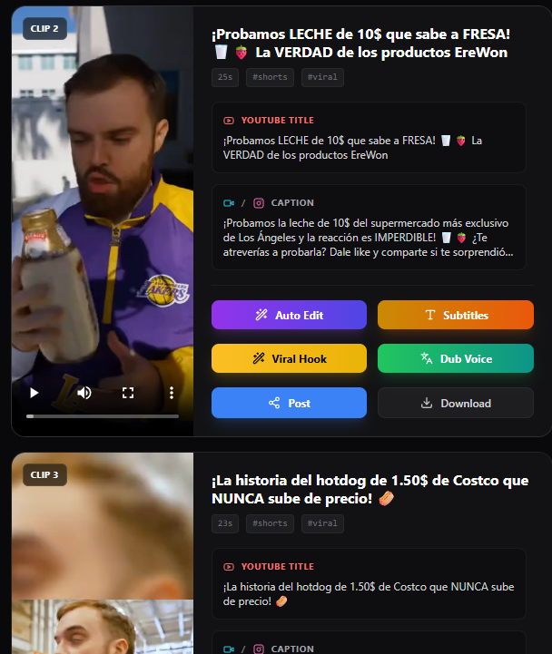
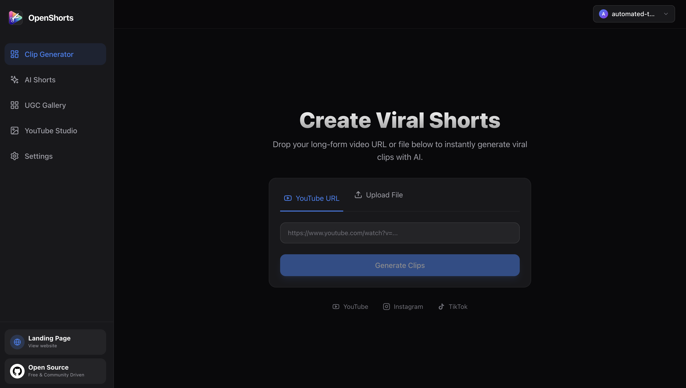
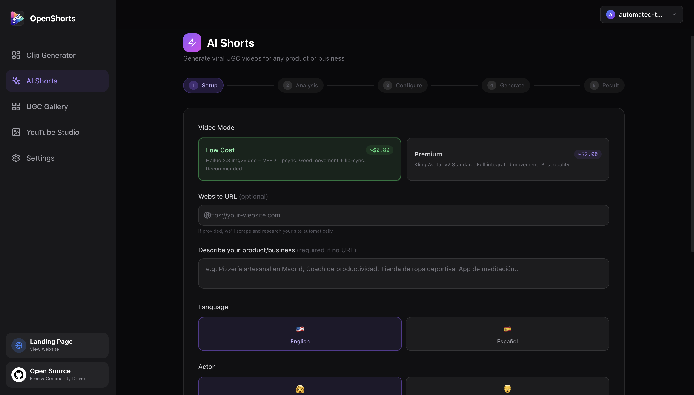
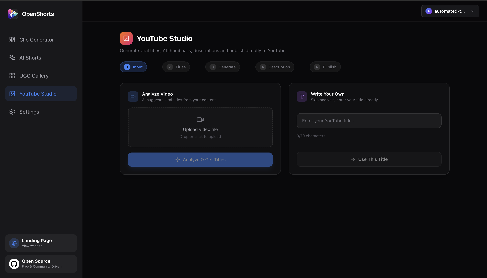

# OpenShorts · TheMegaindex Fork

**Lange Videos schneiden. KI-Shorts erstellen. YouTube-Inhalte vorbereiten.**

Ein erweiterter Fork von [mutonby/openshorts](https://github.com/mutonby/openshorts), gepflegt von [TheMegaindex](https://github.com/Themegaindex). Mit React-Dashboard, Python/FastAPI-Backend und lokaler FFmpeg-Verarbeitung sowie optionalen KI- und Publishing-Diensten.

[English](README.md) · **Deutsch** · [Security-Audit](docs/SECURITY_AUDIT.md) · [Fork-Beiträge](docs/FORK_CONTRIBUTIONS.md)

[Installation](#installation) · [Nutzung](#nutzung) · [Konfiguration](#konfiguration) · [Sicherheit](#security-audit--hardening)



## Funktionen

| Bereich | Möglichkeiten | Externe Dienste |
| --- | --- | --- |
| Clip Generator | Lokale Videos oder unterstützte YouTube-URLs verarbeiten; Clips, Seitenverhältnisse, Untertitel, Hooks und Schnittoptionen auswählen. Einschließlich Longform-Workflows. | Gemini für KI-Analyse; lokales FFmpeg für das Rendering. |
| AI Shorts | Kurzvideos mit KI-Darstellern, Voiceover und ergänzendem Bildmaterial erstellen. | Je nach Workflow Gemini, fal.ai und ElevenLabs. |
| YouTube Studio | Titel, Beschreibungen und Thumbnails vorbereiten; optional über konfigurierte Integrationen veröffentlichen. | Gemini; Publishing-Zugangsdaten nur bei Nutzung. |

CPU-Verarbeitung ist möglich; GPU-Pfade hängen von der installierten Video-/ML-Umgebung ab. Externe Anbieter können Kosten verursachen. Laufzeit und Qualität hängen von Hardware, Ausgangsmaterial und Modellantworten ab.

<details>
<summary>Weitere Screenshots</summary>





</details>

## Voraussetzungen

| Komponente | Anforderung |
| --- | --- |
| Python | **3.11** für die beschriebene Einrichtung und schlanke Tests. |
| Node.js | **Node 24 LTS empfohlen**, mit npm. Das fixierte Vite **8.3.6** verlangt `^20.19.0 \|\| >=22.12.0`. Node 18 wird nicht unterstützt. |
| FFmpeg | `ffmpeg` und `ffprobe` müssen auf `PATH` liegen. |
| Git | Für Clone und historische Vergleiche. |
| KI-Zugangsdaten | Die für den gewählten Workflow benötigten Dienste in den Dashboard-Einstellungen konfigurieren. |

Die Node-Anforderung entspricht der [offiziellen Vite-Dokumentation](https://vite.dev/guide/) und den Paketmetadaten in [package-lock.json](dashboard/package-lock.json). Eine gepflegte Version aus der [offiziellen Node.js-Versionsübersicht](https://nodejs.org/en/about/previous-releases) verwenden. Stand 06.11.2026 ist Node 20 EOL; bestehende CI-/Container-Konfigurationen verwenden weiterhin Node 20 und benötigen ein separat geprüftes Upgrade. Diese Dokumentationskorrektur verändert sie nicht.

## Installation

Einen frischen Clone und eine isolierte Python-Umgebung verwenden. Eine vorhandene Video-/GPU-Umgebung bis zur Prüfung ihres Ersatzes behalten.

```bash
git clone https://github.com/Themegaindex/openshorts-fork.git
cd openshorts-fork
```

### Windows · PowerShell

Zuerst Python 3.11, Node 24 LTS, Git und FFmpeg installieren. Danach im Repository-Root:

```powershell
py -3.11 -m venv .venv
.\.venv\Scripts\python -m pip install --upgrade pip
.\.venv\Scripts\python -m pip install -r requirements.txt
npm --prefix dashboard ci
if (-not (Test-Path .env)) { Copy-Item .env.example .env }
```

### Linux / macOS · Bash

Python 3.11, Node 24 LTS, Git und FFmpeg über den Paketmanager oder offizielle Installer einrichten:

```bash
python3.11 -m venv .venv
./.venv/bin/python -m pip install --upgrade pip
./.venv/bin/python -m pip install -r requirements.txt
npm --prefix dashboard ci
test -f .env || cp .env.example .env
```

Die vollständigen Requirements enthalten große Video-/ML-Abhängigkeiten und können plattformspezifische Wheels oder eine GPU-Einrichtung benötigen. Eine neue vollständige Laufzeitinstallation, GPU-Kompatibilität und die Ausführung unter macOS/Linux wurden im dokumentierten Windows-Audit **nicht verifiziert**. Für eine Prüfung ohne diesen Stack gibt es die [schlanke Security-Testumgebung](docs/SECURITY_TESTING.md).

## Lokal starten

Zwei Terminals im Repository-Root öffnen.

**Terminal 1 — Backend:**

```powershell
# Windows
.\.venv\Scripts\python -m uvicorn app:app --host 127.0.0.1 --port 8000
```

```bash
# Linux / macOS
./.venv/bin/python -m uvicorn app:app --host 127.0.0.1 --port 8000
```

**Terminal 2 — Dashboard, alle Plattformen:**

```bash
npm --prefix dashboard run dev
```

Die von Vite ausgegebene lokale Adresse öffnen, normalerweise **http://localhost:5173**. Das Dashboard leitet API-Aufrufe an **http://127.0.0.1:8000** weiter. Beide Prozesse jeweils mit `Strg+C` stoppen.

Der optionale Windows-Starter `start.bat` erwartet eine Umgebung namens `venv`; diese Anleitung erstellt `.venv`. Mit dieser Einrichtung die manuellen Befehle oben verwenden.

### Optional: Docker Compose

Docker mit Compose und eine private Root-`.env` werden benötigt. Dort einen neu generierten Wert für `OPENSHORTS_API_TOKEN` setzen; die [Security-Testanleitung](docs/SECURITY_TESTING.md#zugriffskonfiguration-und-deployment-smoke-tests) beschreibt Erzeugung und Umgang. Ohne Token verweigert Compose den Start.

```bash
docker compose config --quiet
docker compose up --build
```

Dashboard: **http://localhost:5175**. API: **http://127.0.0.1:8000**. Beide veröffentlichten Ports sind an Loopback gebunden. Der Frontend-Container verwendet den Vite-Entwicklungsserver. Die Befehle wurden mit der Konfiguration abgeglichen; **Docker-Builds und Laufzeitprüfung bleiben offen**, weil Docker beim Audit fehlte. Mit `Strg+C` stoppen, anschließend bei Bedarf `docker compose down` ausführen.

## Nutzung

1. Unter **Settings** die für den Workflow benötigten Anbieter-Keys eintragen.
2. Im **Clip Generator** ein eigenes oder zur Verarbeitung freigegebenes Video hochladen oder eine unterstützte YouTube-URL eingeben. Format und Schnittoptionen wählen, dann den Auftrag starten.
3. Fertige Clips prüfen und ausgewählte Ergebnisse herunterladen. Für die anderen Workflows **AI Shorts** oder **YouTube Studio** öffnen.
4. S3 und Publishing-Integrationen nur bei Bedarf konfigurieren. Vor Uploads oder Veröffentlichungen Ziel und Kontoeinstellungen prüfen.

YouTube-Verfügbarkeit hängt von Plattformbeschränkungen und yt-dlp-Kompatibilität ab. Browser-Cookies sind optional und sensibel; Browserzugriff muss ausdrücklich aktiviert werden und betrifft den Backend-Rechner. Optionen stehen in [.env.example](.env.example).

## Konfiguration

[.env.example](.env.example) ist die Referenz. `.env`, Cookies, Zugangsdaten und generierte Medien gehören nicht in Git.

| Einstellung | Zweck |
| --- | --- |
| `OPENSHORTS_API_TOKEN` | Lokal optional; in Compose erforderlich. Ein gesetztes Token wird für API-/Medienzugriffe verlangt. Vite reicht es serverseitig weiter. Niemals eine `VITE_*`-Variable dafür verwenden. |
| `OPENSHORTS_ALLOWED_HOSTS` / `OPENSHORTS_ALLOWED_ORIGINS` | Akzeptierte Hosts und Browser-Origins begrenzen. Ersetzt keine Benutzeranmeldung. |
| `OPENSHORTS_BACKEND_URL` | Serverseitiges Dashboard-Proxyziel; Compose verwendet `http://backend:8000`. |
| `YOUTUBE_COOKIES_*` | Optionale Browser-/Dateikonfiguration für Cookies. Cookie-Dateien privat halten. |
| `AWS_*` | Optionaler S3-Speicher/Galerie. Manche Workflows laden Galerie-Medien bei entsprechender Einrichtung öffentlich hoch; Datenschutz vorher prüfen. |
| `WATERMARK_*` | Wasserzeichen konfigurieren oder deaktivieren. |

Das Dashboard speichert Anbieter-Keys im Browser mit umkehrbarer Verschleierung, **nicht verschlüsselt**. Anfragen übertragen benötigte Zugangsdaten zur Verarbeitung an das Backend. Einen vertrauenswürdigen Rechner und ein entsprechendes Browserprofil verwenden. Die Anwendung richtet sich an einen vertrauenswürdigen lokalen Betreiber. Öffentlicher Zugriff benötigt ein authentifizierendes HTTPS-Gateway und weitere Betriebskontrollen. Den Vite-Entwicklungsserver nicht öffentlich freigeben.

## Prüfungen und Fehlerbehebung

```powershell
# Windows: isolierte, schlanke Review-Umgebung
py -3.11 -m venv .venv-security
.\.venv-security\Scripts\python -m pip install --upgrade pip
.\.venv-security\Scripts\python -m pip install -r requirements-security.txt
$env:PYTHON_DOTENV_DISABLED = "1"
$env:AWS_EC2_METADATA_DISABLED = "true"
.\.venv-security\Scripts\python -X utf8 -m pytest tests/ -q -rs
npm --prefix dashboard run lint
npm --prefix dashboard run build
```

Vollständige Reproduktion, Scanner-Befehle, Baseline-Fehlschläge, erwartete Skips und Grenzen stehen in [SECURITY_TESTING.md](docs/SECURITY_TESTING.md).

| Problem | Prüfung |
| --- | --- |
| Vite meldet eine ungeeignete Node-Version | `node --version` prüfen; gepflegtes Node 24 LTS verwenden, danach `npm --prefix dashboard ci`. |
| Dashboard erreicht API nicht | Backend auf Port 8000 und übereinstimmende Token-Einstellungen prüfen. Vite nach `.env`-Änderungen neu starten. |
| FFmpeg/ffprobe fehlt | `ffmpeg -version` und `ffprobe -version` im selben Terminal ausführen. |
| YouTube-Download abgelehnt | Fehlermeldung und Cookie-Hinweise prüfen; URL-Validierung und Zugriffsschutz beibehalten. |
| GPU-/Modellfehler | Separate Umgebung verwenden und Abhängigkeiten prüfen; die schlanke Testumgebung ist keine Video-Laufzeit. |

## Security Audit & Hardening

**Independent Security Research, Development & Hardening of an Open-Source Fork.** Der dokumentierte lokale Audit vom 05.11.2026 bestätigt acht Anwendungsschwachstellen und belegt Korrekturen samt Regressionstests. Abhängigkeitsrisiken werden separat erfasst. Dokumentiert sind **632 bestandene / 8 übersprungene** Backend-Tests und **65 bestandene / 1 übersprungener** Security-Test. Das sind datierte lokale Ergebnisse, keine Zertifizierung oder externe Audit-Bestätigung.

Offen bleiben verwundbare Pakete in der vorhandenen Video-Umgebung, NAT64-/Egress-Abdeckung, Zugangsdaten-/Log-/Checkpoint-Behandlung im Worker, Docker-/GPU-/Provider-Verifikation sowie Remote-CI und externe Review-Gates. Vor einem Deployment die Berichte lesen.

| Dokument | Inhalt |
| --- | --- |
| [Security Policy](SECURITY.md) | Unterstützter Sicherheitsumfang und verantwortungsvolle Meldung. |
| [Auditbericht](docs/SECURITY_AUDIT.md) | Bestätigte Findings, Schweregrade, Fixes, Belege und Restrisiken. |
| [Threat Model](docs/THREAT_MODEL.md) | Werte, Angreifer, Vertrauensgrenzen und Maßnahmen. |
| [Security-Tests](docs/SECURITY_TESTING.md) | Reproduktionsbefehle und abgeschlossene/offene Prüfungen. |
| [Fork-Beiträge](docs/FORK_CONTRIBUTIONS.md) | Git-belegte Zuordnung und fixierter Upstream-Vergleich. |
| [Security-Portfolio](docs/SECURITY_PORTFOLIO.md) | Englischer Forschungs- und Entwicklungsbericht. |
| [Dokumentationsprüfung](docs/DOCUMENTATION_REVIEW.md) | Nachprüfung von Installation, Herkunft und Scan-Anleitung. |

## Herkunft und Lizenz

Als erweiterter Fork von **TheMegaindex** gepflegt. OpenShorts stammt aus [mutonby/openshorts](https://github.com/mutonby/openshorts); übernommener Code und integrierte Upstream-Arbeit bleiben ihren ursprünglichen Beitragenden zugeordnet. [FORK_CONTRIBUTIONS.md](docs/FORK_CONTRIBUTIONS.md) trennt übernommenen Code, nachweisbare Fork-Entwicklung und lokales Hardening.

[MIT-Lizenz](LICENSE) · Ursprünglicher Hinweis unverändert: **Copyright (c) 2024 OpenShorts**. Für Bibliotheken, Modelle und Dienste gelten deren eigene Bedingungen.
