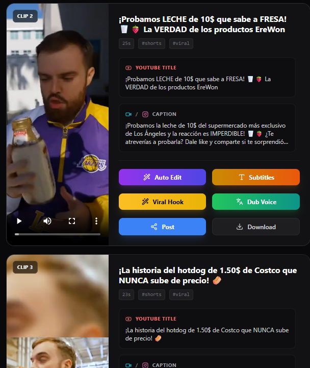
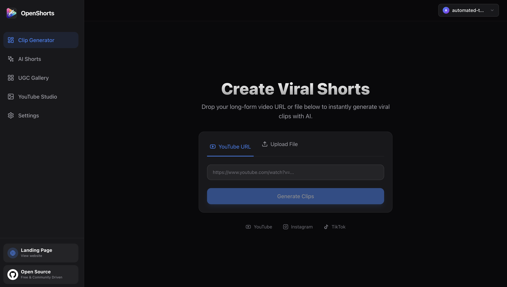
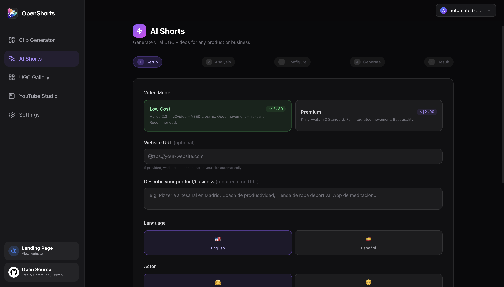
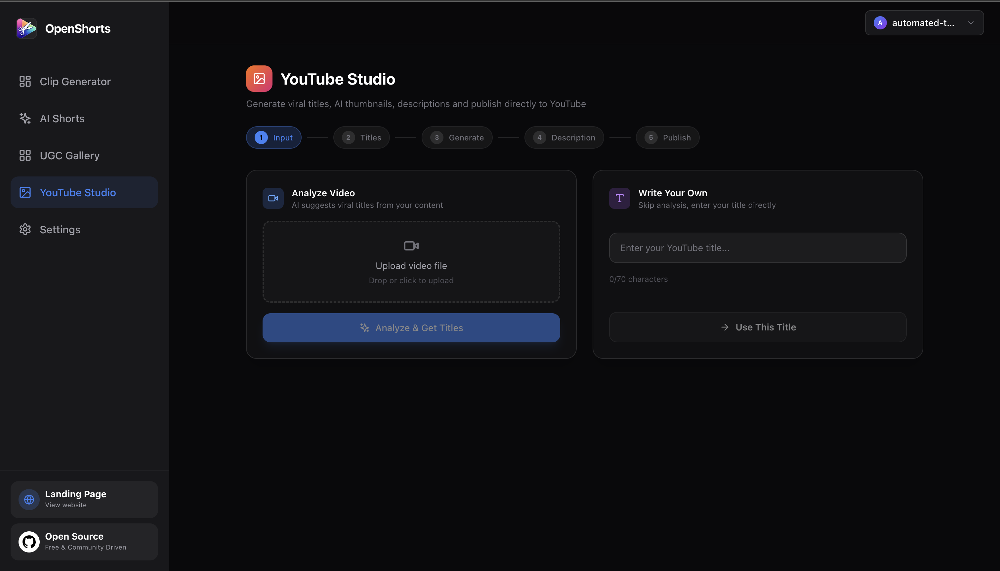

# OpenShorts · TheMegaindex Fork

**Turn long videos into clips. Create AI shorts. Prepare YouTube content.**

An extended fork of [mutonby/openshorts](https://github.com/mutonby/openshorts), maintained by [TheMegaindex](https://github.com/Themegaindex). React dashboard, Python/FastAPI backend, and local FFmpeg processing, with optional external AI and publishing services.

**English** · [Deutsch](README.de.md) · [Security audit](docs/SECURITY_AUDIT.md) · [Fork contributions](docs/FORK_CONTRIBUTIONS.md)

[Get started](#installation) · [Usage](#usage) · [Configuration](#configuration) · [Security](#security-audit--hardening)



## What you can do

| Workspace | Capabilities | External services |
| --- | --- | --- |
| Clip Generator | Upload a local video or provide a supported YouTube URL; select clips, aspect ratios, captions, hooks, and editing options. Includes longform workflows. | Gemini for AI analysis; local FFmpeg for rendering. |
| AI Shorts | Generate short videos with AI actors, voiceovers, and supporting footage. | Gemini, fal.ai, and ElevenLabs, depending on the workflow. |
| YouTube Studio | Prepare titles, descriptions, and thumbnails; optionally publish through configured integrations. | Gemini; publishing credentials only when used. |

CPU processing is available; supported GPU paths depend on your installed video/ML stack. Provider services may charge for usage. Rendering time and output quality depend on hardware, source media, and model responses.

<details>
<summary>More screenshots</summary>





</details>

## Requirements

| Component | Requirement |
| --- | --- |
| Python | **3.11** for the documented setup and lightweight tests. |
| Node.js | **Node 24 LTS recommended**, with npm. The locked Vite **8.3.6** declares `^20.19.0 \|\| >=22.12.0`. Node 18 is unsupported. |
| FFmpeg | Both `ffmpeg` and `ffprobe` on `PATH`. |
| Git | Required to clone the project and reproduce historical comparisons. |
| AI credentials | Configure the services needed by your selected workflow in dashboard Settings. |

The Node requirement follows [Vite's official compatibility guidance](https://vite.dev/guide/) and the package engine metadata in [package-lock.json](dashboard/package-lock.json). Choose a maintained release from the [official Node.js release table](https://nodejs.org/en/about/previous-releases). As checked on 2026-11-06, Node 20 is EOL; existing CI/container configurations still use Node 20 and need a separate validated upgrade. They were not changed by this documentation update.

## Installation

Use a fresh clone and an isolated Python environment. Keep an existing video/GPU environment until a replacement has been validated.

```bash
git clone https://github.com/Themegaindex/openshorts-fork.git
cd openshorts-fork
```

### Windows · PowerShell

Install Python 3.11, Node 24 LTS, Git, and FFmpeg first. Then, from the repository root:

```powershell
py -3.11 -m venv .venv
.\.venv\Scripts\python -m pip install --upgrade pip
.\.venv\Scripts\python -m pip install -r requirements.txt
npm --prefix dashboard ci
if (-not (Test-Path .env)) { Copy-Item .env.example .env }
```

### Linux / macOS · Bash

Install Python 3.11, Node 24 LTS, Git, and FFmpeg using your platform's package manager or official installers:

```bash
python3.11 -m venv .venv
./.venv/bin/python -m pip install --upgrade pip
./.venv/bin/python -m pip install -r requirements.txt
npm --prefix dashboard ci
test -f .env || cp .env.example .env
```

The full requirements include large video/ML dependencies and may require platform-specific wheels or GPU setup. A new full runtime installation, GPU compatibility, and macOS/Linux execution were **not verified** in the recorded Windows audit. For review without that stack, use the [lightweight security-test environment](docs/SECURITY_TESTING.md).

## Start locally

Open two terminals in the repository root.

**Terminal 1 — backend:**

```powershell
# Windows
.\.venv\Scripts\python -m uvicorn app:app --host 127.0.0.1 --port 8000
```

```bash
# Linux / macOS
./.venv/bin/python -m uvicorn app:app --host 127.0.0.1 --port 8000
```

**Terminal 2 — dashboard, all platforms:**

```bash
npm --prefix dashboard run dev
```

Open the local URL printed by Vite, normally **http://localhost:5173**. The dashboard proxies API requests to **http://127.0.0.1:8000**. Stop each process with `Ctrl+C`.

The optional Windows `start.bat` launcher expects an environment named `venv`, whereas this guide creates `.venv`. Use the manual commands above with this setup.

### Optional Docker Compose

Requires Docker with Compose and a private root `.env`. Set a newly generated `OPENSHORTS_API_TOKEN` there; the [security testing guide](docs/SECURITY_TESTING.md#zugriffskonfiguration-und-deployment-smoke-tests) explains generation and handling. Compose refuses to start without it.

```bash
docker compose config --quiet
docker compose up --build
```

Dashboard: **http://localhost:5175**. API: **http://127.0.0.1:8000**. Both published ports bind to loopback. The frontend container runs the Vite development server. These Docker instructions were inspected against the configuration; **Docker builds and runtime checks remain unverified** because Docker was unavailable during the audit. Stop with `Ctrl+C`, then `docker compose down` if needed.

## Usage

1. Open **Settings** and configure the provider keys needed for your workflow.
2. In **Clip Generator**, upload a video you own or are authorized to process, or enter a supported YouTube URL. Choose the aspect ratio and editing options, then start the job.
3. Review completed clips and download the selected results. Use **AI Shorts** or **YouTube Studio** for their respective workflows.
4. Configure S3 or publishing integrations only if you intend to use them. Review destinations and account settings before uploading or publishing.

YouTube availability depends on platform restrictions and yt-dlp compatibility. Browser cookies are optional and sensitive; browser access is opt-in and applies to the machine running the backend. See [.env.example](.env.example) for the supported options.

## Configuration

Use [.env.example](.env.example) as the configuration reference. Keep `.env`, cookies, provider credentials, and generated media out of Git.

| Setting | Purpose |
| --- | --- |
| `OPENSHORTS_API_TOKEN` | Optional for local access; required by Compose. When set, API and media requests require it. Vite forwards it server-side. Never use a `VITE_*` variable for this secret. |
| `OPENSHORTS_ALLOWED_HOSTS` / `OPENSHORTS_ALLOWED_ORIGINS` | Restrict accepted hosts and browser origins. They do not replace user authentication. |
| `OPENSHORTS_BACKEND_URL` | Server-side dashboard proxy target; Compose uses `http://backend:8000`. |
| `YOUTUBE_COOKIES_*` | Optional browser/file cookie configuration. Keep cookie files private. |
| `AWS_*` | Optional S3 storage/gallery. Some configured workflows upload gallery media publicly; assess privacy before enabling. |
| `WATERMARK_*` | Configure or disable the rendering watermark. |

The dashboard stores provider keys in browser storage using reversible obfuscation, **not encryption**. Requests send relevant credentials to the backend for processing. Use a trusted browser profile and machine. This application is intended for a trusted local operator; public access requires an authenticating HTTPS gateway and additional operational controls. Do not expose the Vite development server publicly.

## Checks and troubleshooting

```powershell
# Windows: isolated, lightweight review environment
py -3.11 -m venv .venv-security
.\.venv-security\Scripts\python -m pip install --upgrade pip
.\.venv-security\Scripts\python -m pip install -r requirements-security.txt
$env:PYTHON_DOTENV_DISABLED = "1"
$env:AWS_EC2_METADATA_DISABLED = "true"
.\.venv-security\Scripts\python -X utf8 -m pytest tests/ -q -rs
npm --prefix dashboard run lint
npm --prefix dashboard run build
```

Full reproduction, scanner commands, baseline failures, expected skips, and known limitations are in [SECURITY_TESTING.md](docs/SECURITY_TESTING.md).

| Symptom | Check |
| --- | --- |
| Vite reports an unsupported engine | Run `node --version`; use maintained Node 24 LTS, then `npm --prefix dashboard ci`. |
| Dashboard cannot reach the API | Confirm the backend is running on port 8000 and that token settings match. Restart Vite after changing `.env`. |
| FFmpeg/ffprobe not found | Run `ffmpeg -version` and `ffprobe -version` in the same terminal environment. |
| YouTube download rejected | Read the error and cookie guidance; do not disable URL validation or access controls. |
| GPU/model dependency errors | Use a separate environment and validate supported dependencies; the lightweight test environment is not a video runtime. |

## Security Audit & Hardening

**Independent Security Research, Development & Hardening of an Open-Source Fork.** The recorded local audit (2026-11-05) confirms eight application findings and documents their fixes and regressions. Dependency risk is tracked separately. Recorded results include **632 passed / 8 skipped** backend tests and **65 passed / 1 skipped** security tests; these are dated local results, not certification or an external audit endorsement.

Open work includes vulnerable packages in the pre-existing video environment, NAT64/egress coverage, worker credential/log/checkpoint handling, Docker/GPU/provider verification, and remote CI/review gates. Read the reports before deployment.

| Document | Content |
| --- | --- |
| [Security policy](SECURITY.md) | Supported security scope and responsible disclosure. |
| [Audit report](docs/SECURITY_AUDIT.md) | Confirmed findings, severity, fixes, evidence, and remaining risk. |
| [Threat model](docs/THREAT_MODEL.md) | Assets, attackers, boundaries, and mitigations. |
| [Security testing](docs/SECURITY_TESTING.md) | Reproducible commands and completed versus pending checks. |
| [Fork contributions](docs/FORK_CONTRIBUTIONS.md) | Git-backed attribution and pinned upstream comparison. |
| [Security portfolio](docs/SECURITY_PORTFOLIO.md) | English research and development summary. |
| [Documentation verification](docs/DOCUMENTATION_REVIEW.md) | Follow-up checks for installation, provenance, and scan instructions. |

## Credits and license

Maintained as an extended fork by **TheMegaindex**. OpenShorts originates from [mutonby/openshorts](https://github.com/mutonby/openshorts); inherited code and merged upstream work remain attributed to their original contributors. [FORK_CONTRIBUTIONS.md](docs/FORK_CONTRIBUTIONS.md) separates inherited work, verifiable fork development, and local hardening.

[MIT License](LICENSE) · Original notice preserved: **Copyright (c) 2024 OpenShorts**. Third-party libraries, models, and provider services have their own terms.
