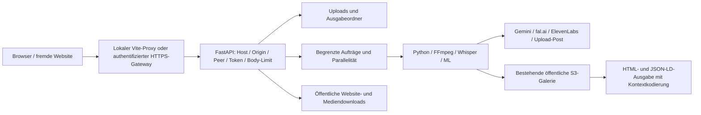

# Threat Model – OpenShorts

Stand: **2026-11-05**. Ausgangspunkt: `98afa9ea5e9a842eb358834fe0cbd251d335573b`; betrachtet werden die lokalen Hardening-Änderungen. Die Bezeichnung „Openshore“ aus dem Auftrag wird hier dem tatsächlich vorhandenen Repository **OpenShorts** zugeordnet.

## Geschützte Werte

| Wert | Schutzbedarf |
| --- | --- |
| Originalvideos, Gesichter, Stimme, Transkripte, Checkpoints | Vertraulichkeit; keine unbeabsichtigte Auslieferung oder Übertragung |
| Gemini-, ElevenLabs-, fal.ai-, Upload-Post- und AWS-Schlüssel; YouTube-Cookies | Geheimhaltung, bestimmungsgemäße Nutzung, Kostenkontrolle |
| Projektdateien, Modelle, Host-Dateisystem | Keine über Eingabepfade erreichbaren fremden Dateien oder Überschreibungen |
| CPU/GPU, RAM, Datenträger, Prozessplätze | Begrenzte Ressourcenbelegung und wiederherstellbare Verarbeitung |
| Veröffentlichte Clips und Metadaten | Integrität; kein ausführbares HTML in Galerie-Seiten |
| Abhängigkeiten und Docker-Images | Herkunft, bekannte Advisories, reproduzierbare Prüfung |

## Betriebsannahmen und Angreifer

Die Anwendung gehört einem vertrauenswürdigen Betreiber. Lokale Betriebssystemkonten, das Projektverzeichnis und `.env` gelten als vertrauenswürdig. Ein Angreifer mit denselben Dateisystemrechten kann Code, Schlüssel oder Symlinks direkt verändern; das ist keine durch diese Anwendung isolierte Sicherheitsdomäne.

Betrachtete Angreifer sind fremde Netzwerkclients, eine bösartige Website im Browser des Betreibers, manipulierte Uploads und URLs sowie unzuverlässige externe Seiten, Modellantworten oder Galerie-Metadaten. Ein gemeinsam verwendetes Betreiber-Token trennt mehrere Benutzer nicht voneinander. Ein kompromittierter Betriebssystemkern oder Anbieter wird nicht als erfolgreich abgewehrt behauptet.

## Datenfluss und Vertrauensgrenzen

| Grenze | Bedrohung | Eingeführte oder vorhandene Kontrolle | Grenze der Kontrolle |
| --- | --- | --- | --- |
| Browser/Netzwerk → API | Unberechtigte Aufträge, Abbruch, Dateiabruf, CSRF/DNS-Rebinding | Lokaler Peer oder Token; Host- und Origin-Prüfung; auch bei ASGI-`root_path` | Lokaler Proxy kann den Peer verdecken; externe Anmeldung muss vor dem Proxy stattfinden |
| Eingaben → Dateisystem | Traversal, absolute Windows-/UNC-Pfade, Überschreiben | Begrenzte IDs, `confined_path`, serverseitige UUID-Namen, exklusives Erstellen | Keine Isolation gegenüber einem lokalen Benutzer mit Schreibrechten; keine vollständige Race-Sandbox |
| Ausgabeordner → HTTP | Transkript-/Zustandsleck | Medien-Endungen erlaubt, JSON/dotfiles gesperrt, `nosniff` | Berechtigte Betreiber können Medien desselben Betreibers sehen |
| Website/Provider-URL → Netzwerk | SSRF und Weiterleitungen auf interne Adressen | HTTP(S), Standardports, öffentliche DNS-Antworten, gepinnte Ziel-IP mit Host/SNI, jede Weiterleitung geprüft | Gilt für die neuen Web-/Mediendownload-Helper; nicht als globale Egress-Firewall aller SDKs zu verstehen |
| YouTube-URL → yt-dlp | Freie Generic-Extractor-Ziele, Playlists, große Downloads | YouTube-Hostliste, YouTube-Extractor-Liste, `noplaylist`, Größenoption | Provider-CDNs und yt-dlp-Protokolle bleiben vertraute Drittkomponenten; Größe bei fehlender Metadatenlänge nur best effort |
| Externe Antwort → Speicher | Unbegrenzte Antwort, Kompressionsbomben, langsames Streaming | Byte-/Zeitgrenzen, rohe Stream-Chunks, Identity-Encoding, temporäre Datei | Kein globales CPU-/Datenträgerkontingent; HTTP-Read-Timeout bleibt eine zusätzliche Grenze |
| Metadaten → HTML/JSON-LD | Gespeichertes XSS, gefährliche Link-Schemata | HTML-Attribut-/Textkodierung, Schema-Prüfung, JSON-Serialisierung und `<`-Escaping | Kein vollständiger Browser-CSP-Umbau; bestehende Inline-Ereignisse bleiben |
| Modell → FFmpeg | Freie Filter, Sekundärdateien, Code-/Prozessausführung | Argumentlisten und deterministische Effekterstellung, auch bei Reparaturen | Medienparser werden nicht sandboxed; bösartige Container und native Bibliotheken bleiben relevant |
| Nutzerparameter → Arbeit | Thread-/Auftrags- und Kostenvervielfachung | Höchstens 6 Actor-Optionen/Skripte, 30 Segmente, 20 neue ausstehende Jobs, 64 HTTP-Anfragen je Prozess, gemeinsames Semaphore | Keine dauerhaften Benutzerquoten oder verteilte Queue; Grenzen gelten pro Prozess |
| Provider-JSON → authentifizierter Folgeaufruf | Weitergabe des fal.ai-Schlüssels an ein fremdes Ziel | Queue-Folge-URLs auf `https://queue.fal.run` begrenzt | Kompromittierte vertrauenswürdige Anbieter bleiben ein eigenes Risiko |
| Git/Build → Installation | Secrets im Image, verwundbare Abhängigkeiten | Ignore-Regeln, redigierter Signaturscan, npm-Lock-Update, Python-Constraints | Python ist nicht vollständig gelockt; OS- und Image-Layer wurden nicht gescannt |

## Relevante Restrisiken

1. Die vorgefundene `venv` enthält weiterhin die vom Scanner gemeldeten alten Pakete. Die neue Audit-Umgebung ersetzt diese Installation nicht.
2. Vollständige Video-/GPU-Verarbeitung und externe Anbieterintegration wurden nicht durch reale, kostenpflichtige Aufrufe geprüft. FFmpeg-Integrationstests liefen mit synthetischen Medien.
3. Die Anwendung ist kein Mandantensystem. Öffentlicher Betrieb erfordert vorgelagerte Authentifizierung, TLS, Netzwerk-Egress-Regeln sowie Betriebssystem-/Container-Ressourcenlimits.
4. API-Schlüssel liegen weiterhin im Browser-`localStorage`; vorhandene XOR-Kodierung ist keine sichere Verschlüsselung. Browserprofil und Erweiterungen müssen vertrauenswürdig sein.
5. Schrift-/Modelldownloads von festen HTTPS-Quellen sind nicht durch eigene Prüfsummen gebunden. Anbieter-/Modell-Supply-Chain und automatischer öffentlicher S3-Upload bleiben Betriebsentscheidungen.
6. Upload-/Downloadlimits begrenzen einzelne Vorgänge. Ein vertrauenswürdiger Betreiber kann über längere Zeit dennoch Datenträger füllen; Aufbewahrung und Quoten sind betrieblich zu überwachen.

Die zugeordneten Nachweise und offene Prüfungen stehen im [Auditbericht](SECURITY_AUDIT.md).
